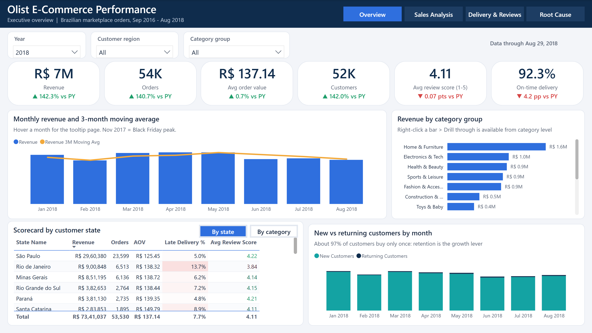
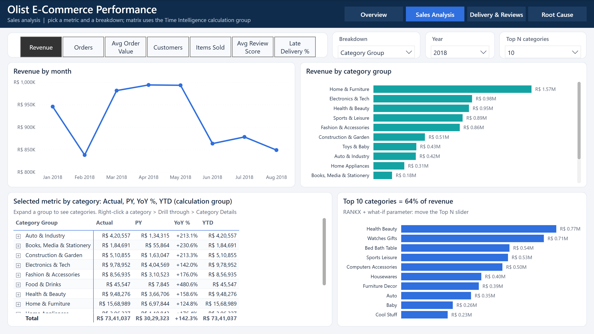
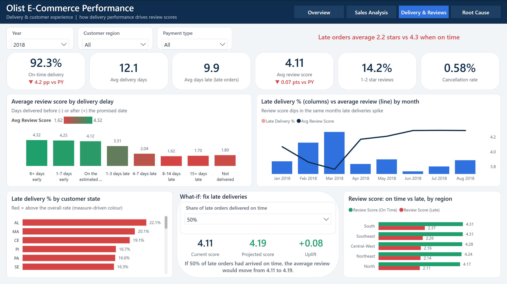
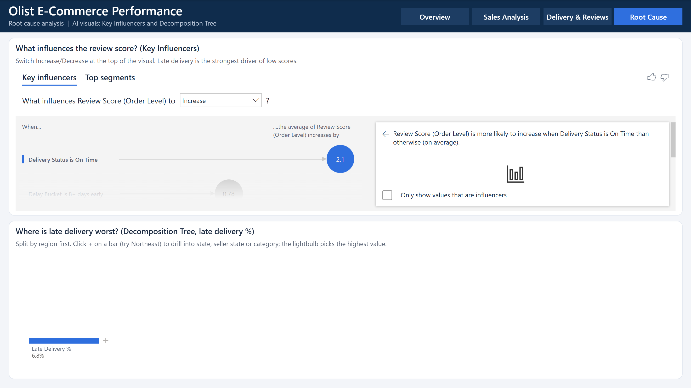
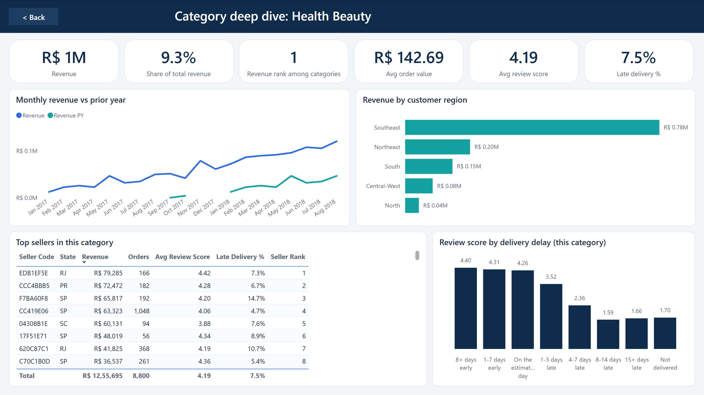
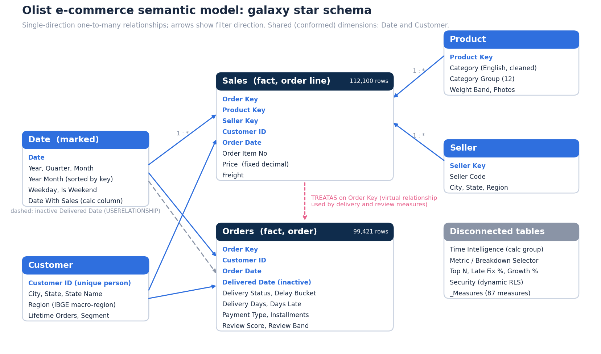

# Olist E-Commerce Performance Dashboard (Power BI)

An end-to-end Power BI project on **99K real orders** from Olist, a Brazilian e-commerce marketplace (Sep 2016 to Aug 2018). Raw CSV files are cleaned in Power Query, modelled as a star schema with two fact tables, analysed with **87 DAX measures**, and presented in a 6-page interactive report. Saved as a **Power BI Project (PBIP)**, so the model (TMDL) and the report (PBIR) are plain text and version-controlled.

**Project walkthrough (11 slides):** [docs/Olist_PowerBI_Project_Walkthrough.pdf](docs/Olist_PowerBI_Project_Walkthrough.pdf) · **LinkedIn post:** [read it here](https://www.linkedin.com/feed/update/urn:li:activity:7517734798321233920/)



## Key findings

| Finding | Number |
|---|---|
| Revenue growth, Jan to Aug 2018 vs same period 2017 | **+142%** (R$ 7.34M vs R$ 3.03M) |
| Late deliveries | **6.8%** of delivered orders |
| Review score when late vs on time | **2.27 vs 4.29** stars |
| Revenue from the top 20% of sellers | **82.6%** |
| Customers who bought only once | **97%** |
| Share of revenue from São Paulo state | **38%** |
| Best month | Nov 2017 (Black Friday), about R$ 1.0M |

**Recommendation:** delivery reliability, not marketing, is the biggest lever on customer satisfaction. Late orders concentrate in north-eastern states (Alagoas 21%, Maranhão 18% late vs 6.8% overall), and the what-if model shows that fixing half of the late orders lifts the average review from 4.12 to 4.18.

## Report pages

| Page | What it shows | Techniques |
|---|---|---|
| Executive Overview | KPIs with YoY, revenue trend with 3-month moving average, category and state scorecards, new vs returning customers | KPI cards with measure-driven colours, report-page tooltip, bookmarks + buttons, data bars and gradient formatting |
| Sales Analysis | Any metric by any breakdown; Actual / PY / YoY % / YTD matrix; Top N categories | Field parameters, calculation group, RANKX + what-if Top N, dynamic titles |
| Delivery & Reviews | Review score by delivery delay, late % by state and month, what-if scenario | TREATAS virtual relationship, measure-based bar colours, what-if parameter |
| Root Cause | Drivers of low reviews, origin of late orders | Key Influencers, Decomposition Tree |
| Category Details | Drill-through page for one product category | Drill-through, Back button, ALL / REMOVEFILTERS ranking |
| Tooltip - Month | Mini report shown on hover | Tooltip page |

| | |
|---|---|
|  |  |
|  |  |

## Data model



- **Facts:** `Sales` (order-line grain, 112,100 rows: price, freight) and `Orders` (order grain, 99,421 rows: delivery, payment, review). Kept at their natural grain so order-level values are never double counted.
- **Dimensions:** `Date` (marked date table), `Customer` (deduplicated on `customer_unique_id`), `Product` (English categories + 12 category groups), `Seller`.
- Single-direction one-to-many relationships; an **inactive** relationship on Delivered Date used with `USERELATIONSHIP`.
- `Orders` is not related to Product or Seller; order-level measures use **`TREATAS`** to pick up those filters through `Sales` (a virtual relationship) instead of bi-directional filtering.
- Integer surrogate keys for Order, Product and Seller.
- Disconnected tables: a **calculation group** (Time Intelligence), two **field parameters**, three **what-if parameters** and a **Security** table for dynamic RLS.

## Power Query (M)

- `DataFolder` parameter, so the project refreshes on any machine.
- Reusable functions: `fx_LoadCsv` (UTF-8, quoted multi-line fields, BOM removal, blanks to null) and `fx_CleanText`.
- Staging queries (load disabled) for orders, items, reviews, payments and category translation.
- Cleaning: removed incomplete months (Sep to Oct 2018, 20 orders), averaged 547 duplicate reviews, fixed translation typos and 2 missing categories, labelled 610 uncategorized products, derived delivery days, days late, delay buckets and review bands.

## DAX highlights

Measures live in a `_Measures` table with numbered display folders (Sales, Time Intelligence, Customers, Delivery & Reviews, Ranking & Top N, What-If, Labels & Formatting).

**Fair year-over-year for a partial year.** 2018 ends on 29 Aug, so the prior-year window only shifts dates that have sales:

```dax
Revenue PY =
CALCULATE (
    [Revenue],
    CALCULATETABLE ( SAMEPERIODLASTYEAR ( 'Date'[Date] ), 'Date'[Date With Sales] = TRUE )
)
```

**Virtual relationship so delivery metrics work by product and seller:**

```dax
Late Orders =
CALCULATE (
    COUNTROWS ( Orders ),
    KEEPFILTERS ( Orders[Delivery Status] = "Late" ),
    TREATAS ( VALUES ( Sales[Order Key] ), Orders[Order Key] )
)
```

**Calculation group** (Actual, PY, YoY, YoY %, YTD, PYTD, Last 3 Months) with an allow-list and a dynamic format string:

```dax
-- calculation item 'YoY %'
VAR _PY =
    CALCULATE ( SELECTEDMEASURE (), CALCULATETABLE ( SAMEPERIODLASTYEAR ( 'Date'[Date] ), 'Date'[Date With Sales] = TRUE ) )
RETURN
    IF (
        ISSELECTEDMEASURE ( [Revenue], [Orders], [Customers], [AOV], [Avg Review Score], ... ),
        DIVIDE ( SELECTEDMEASURE () - _PY, _PY ),
        SELECTEDMEASURE ()
    )
```

**New customers in a period** (set logic with EXCEPT):

```dax
New Customers =
VAR _FirstDate = MIN ( 'Date'[Date] )
VAR _CustomersBefore =
    CALCULATETABLE ( VALUES ( Sales[Customer ID] ), REMOVEFILTERS ( 'Date' ), 'Date'[Date] < _FirstDate )
RETURN
    COUNTROWS ( EXCEPT ( VALUES ( Sales[Customer ID] ), _CustomersBefore ) )
```

**Pareto check: revenue share of the top 20% of sellers:**

```dax
Top 20% Sellers Share % =
VAR _Sellers = FILTER ( ADDCOLUMNS ( ALLSELECTED ( Seller[Seller Code] ), "@Revenue", [Revenue] ), [@Revenue] > 0 )
VAR _Top = TOPN ( ROUNDUP ( COUNTROWS ( _Sellers ) * 0.2, 0 ), _Sellers, [@Revenue], DESC )
RETURN
    DIVIDE ( SUMX ( _Top, [@Revenue] ), SUMX ( _Sellers, [@Revenue] ) )
```

Also: RANKX Top N driven by a what-if slider, rolling 3-month and moving-average measures, a what-if review-score projection, hex-colour measures for conditional formatting, and the `SUMMARIZE` pattern for reading a field-parameter selection (SELECTEDVALUE fails on field-parameter columns because they form a composite key).

## Row-level security

| Role | Rule |
|---|---|
| Southeast Region | `Customer[Region] = "Southeast"` |
| North and Northeast | `Customer[Region] IN { "North", "Northeast" }` |
| Regional Manager (Dynamic) | `Customer[Region] IN CALCULATETABLE ( VALUES ( Security[Region] ), Security[User Email] = USERPRINCIPALNAME () )` |

Test in Desktop with **Modeling > View as > Other user**, for example `south.manager@olist-demo.com` (demo addresses).

## Validation

Every headline KPI was recomputed independently from the raw CSVs in Python (pandas) and matched the DAX results exactly: revenue R$ 13,494,255.74, 98,198 orders, 94,983 customers, 6,534 late orders (6.77%), review scores 4.29 on time vs 2.27 late, repeat rate 3.04%, top-20% seller share 82.6%.

## How to open it

1. Install Power BI Desktop (free).
2. Clone the repo and open `OlistAnalytics.pbip`, or open `OlistAnalytics.pbix`.
3. For the PBIP: Transform data > Edit parameters > set `DataFolder` to the full path of `data/raw/` in your clone (end with a backslash), then **Refresh**.

```
olist-ecommerce-powerbi/
├── OlistAnalytics.pbip                # open this in Power BI Desktop
├── OlistAnalytics.pbix                # single-file version with data
├── OlistAnalytics.SemanticModel/      # TMDL: tables, measures, relationships, roles, Power Query
├── OlistAnalytics.Report/             # PBIR: pages, visuals, bookmarks, theme
├── data/raw/                          # Olist CSV files (CC BY-NC-SA 4.0)
└── docs/                              # screenshots + project walkthrough PDF
```

## Data source and licence

[Brazilian E-Commerce Public Dataset by Olist](https://www.kaggle.com/datasets/olistbr/brazilian-ecommerce), published by Olist on Kaggle under **CC BY-NC-SA 4.0**. The CSV files in `data/raw` are redistributed unchanged under the same licence, for non-commercial portfolio use with attribution. The geolocation file is not included. Prices are in Brazilian reais (R$).

## Author

**Uttkarsh Singh**, Data Analyst · [LinkedIn](https://linkedin.com/in/uttkarshsinghdata) · [GitHub](https://github.com/uttkarshrajput)
